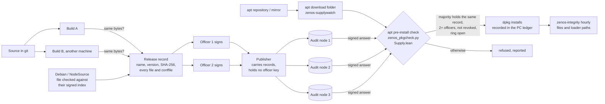

# ZENOS architecture

How the code is divided, which part runs with which privilege, and how the parts talk to each other.
The security design itself (chains, open sequence, ledger tiers) is in [SECURITY_ARCHITECTURE.md](SECURITY_ARCHITECTURE.md);
what is and is not protected today is in [THREAT_MODEL.md](THREAT_MODEL.md).

## Three privilege zones

```
 desktop user (ordinary privileges)          root services (one machine)            servers (other parties)
 ─────────────────────────────────           ────────────────────────────           ───────────────────────
 core/bin     apps, browser, file picker     system/sbin  guardd   keyd             storage/      storage nodes
 apps/        Documents, Sheets, Slides...                netsentinel  secstat         packaging/grid audit nodes
 messenger/   ZENOS Messages client                       trustwatch   auditship
 desktop/     Plasma launcher, level, monitor             heartbeat    siren ...
        │                                            ▲          │
        └── /run/zenos/guardd.sock, keyd.sock ───────┘          └── ledger shipping (TLS) ──► audit node
            (requests; root decides)                 /run/zenos/*.json (status; read-only for the desktop)
```

- The desktop side never holds level keys and never enforces anything on its own; it asks the root services over
  two Unix sockets (`guardd.sock` for approvals, stop and release; `keyd.sock` for every seal and unseal).
- Root services publish their state as world-readable JSON in `/run/zenos/` (`secstat.json`, `trust.json`); the
  System Monitor only reads these files. Nothing in them is secret.
- Servers run in the `zenos-grid` package, on machines the PC user does not control.

## Where the code lives

| Directory | Runs as | Contents |
|---|---|---|
| `core/bin/` | desktop user | `zenos.py` (sealed `.zen` files, approvals), browser, app shell, file picker, lock screen, Vault, pre-send check; `zenos-*.sh` launchers |
| `core/shell/`, `core/icons/`, `core/templates/` | desktop user | HTML chrome, icons, new-file templates |
| `apps/` | desktop user | Documents, Sheets, Slides (Vite + TypeScript, served by `apps/common/zoffice_server.py` on localhost), PDF, Images, Video |
| `messenger/` (AGPL-3.0) | desktop user | ZENOS Messages: client, relay, web UI, calls |
| `desktop/` | desktop user | Plasma plasmoids (launcher, level indicator, monitor), `.desktop` files, autostart |
| `system/sbin/` | root | one program per service, `zenos_<name>.py`, started by the units in `system/systemd/` |
| `system/lib/` | root and desktop | the shared library, installed to `/usr/lib/zenos` (see below) |
| `storage/` | servers | erasure-coded storage nodes and grid bootstrap (Node.js) |
| `packaging/` | build | `build-deb.sh` (the `zenos` package), `build-grid-deb.sh` (`zenos-grid`), `iso/` (installer image) |
| `config/examples/` | — | example configuration for the servers |
| `formal/` | root (as `/usr/lib/zenos/zenos-decide`) | the decisions keyd and guardd take, in Lean 4 with machine-checked proofs ([FORMAL_VERIFICATION.md](FORMAL_VERIFICATION.md)) |
| `tests/` | — | unit tests (`test_*.py`) and Node tests (`messenger_*.js`) |
| `third_party/` | desktop user | modified KDE plasmoids under their original licenses |

## The shared library (`system/lib` → `/usr/lib/zenos`)

| Module | Purpose |
|---|---|
| `zconf` | where ZENOS lives on this machine (program directory, desktop user, data directory) |
| `zformat` | the `.zen` file format, levels, and the approval-request digest: the contract between desktop and root |
| `zledger`, `zanchor` | hash-chained ledger and its anchoring to the consortium tier |
| `zfrag` | per-fragment encryption for the storage grid |
| `zalarm` | alerts (amber notices, red siren and dispatch) |
| `zsecnote` | periodic endpoint audit |
| `zdecide` | runs the proven decision program and turns anything unexpected into a refusal |
| `zdistrust` (`.py`, `.js`) | certificates and keys ZENOS refuses (`distrust.json`, plus Mozilla's signed list learned by `zenos_trustwatch`) |

Rules:

- Root services import only from the root-owned library. They find it at `../lib/zenos` relative to their own
  location (`/usr/sbin` → `/usr/lib/zenos`), never from the program directory or a user-writable path.
- Desktop programs look for the library in `/usr/lib/zenos`, then in the development layout `/usr/local/lib/zenos`.
- What both sides must agree on (file format, levels, the request digest) lives in `zformat`, not in `zenos.py`.
- Tests put `system/lib`, `core/bin` and `system/sbin` of the repository first on the path.

## Root services

| Service | Program | Job |
|---|---|---|
| `zenos-keyd` | `zenos_keyd.py` | holds the level keys; seals and unseals for desktop users by clearance or officer grant (decided by `zenos-decide`) |
| `zenos-guardd` | `zenos_guardd.py` | watches the security folders and the external exit; approvals, stop and release (decided by `zenos-decide`) |
| `zenos-firewall` | `zenos-firewall` | inbound lockdown chain `ZENOS_IN` |
| `zenos-netsentinel` | `zenos_netsentinel.py` | eBPF view of outbound traffic; cuts unapproved egress (`ZENOS_OUT`), open-time cut via `zenos_openguard` |
| `zenos-secstat` | `zenos_secstat.py` | the security monitor feed: blocked inbound, failed sign-ins, remote operation, pending fixes, trust alerts |
| `zenos-trustwatch` | `zenos_trustwatch.py` | inventories every trust store, learns Mozilla's signed distrust list, installs trust fixes |
| `zenos-auditship` | `zenos_auditship.py` | ships the ledgers to the audit nodes |
| `zenos-heartwatch` | `zenos_heartbeat.py` | dead-man's switch for the sensors |
| (on demand) | `zenos_siren.py` | full-screen red alert until acknowledged |

## From source to an installed package



Checked at each step: the two builds give the same bytes (`packaging/repro-check.sh`); a file from Debian or
NodeSource is the one their signed index names (`--apt-check`); each officer signs the record's digest with their
own key; the audit nodes accept only records that continue their chain and sign every answer; the PC accepts a file
only on a majority of identical node answers and enough officer signatures (`decideInstall`); after installation,
the files stay the ones in the record (`zenos-integrity`).

## Conventions

- Python modules and service programs: `snake_case`, services prefixed `zenos_`, library modules prefixed `z`.
- Launchers a person or the desktop starts: `zenos-<app>.sh`.
- User-facing text is English. Comments say why, not what.
- Every program states its purpose in its first docstring line.
